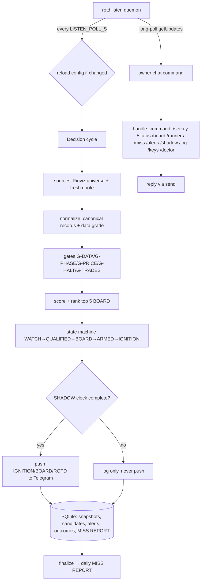

# ROTD — Runner of the Day

**A separate, stricter system that surfaces the few sub-$10 US stocks most likely
to be that day's explosive runner (+100% or more), as early as the evidence
allows — and stays silent the rest of the time.**

ROTD is decision support only. It places no orders, never shorts, and never
promises a move. It exists because the earlier penny early-warning system
(`penny-early-warning`, read-only reference in this repo) alerts too often and
its data is inconsistent. ROTD fixes that structurally:

- **Rank, then budget** — candidates compete; an alert is a scarce resource spent
  on the day's best name, not a reaction to a per-stock threshold.
- **One snapshot of truth** — every decision reads one reconciled, timestamped
  snapshot per cycle. No module fetches its own data in the decision path.
- **Fail closed** — missing, stale or conflicting data lowers the data-quality
  grade and suppresses alerts. It never becomes a pass.
- **Code counts, model reads** — all numbers, scores and ranks come from code.
  The language model only classifies news and filings, asynchronously, and can
  never raise a score above the rules-only verdict.
- **Daily self-measurement** — a MISS REPORT explains, for every sub-$10 runner
  the day produced, exactly why ROTD did or did not flag it, and how early.

## Install

Mirrors the `penny-early-warning` installer. Download the script and run it
**directly** (don't pipe it into bash — it needs to read your answers from the
terminal):

```bash
wget -O install.sh https://raw.githubusercontent.com/Ace1337z/big-whale-penny-tracker/main/install.sh
bash install.sh
```

The installer (idempotent, 9 steps):
1. **Credentials first** — asks **only** for your Telegram bot token + chat id
   (hidden input; everything else is a safe default).
2. Installs system packages (python3, venv, pip, wget, tar).
3. Downloads the source tarball into `/opt/rotd`.
4. Creates a venv and installs the package (`pip install -e .[dev]`).
5. Writes `config.env` (mode 600) via `rotd setup --non-interactive`.
6. Auto-detects the Telegram chat id (message the bot, or set it later).
7. Installs + enables a `systemd` service (`deploy/rotd.service`).
8. Runs the offline self-test and the live `doctor` check.
9. Starts the service (`journalctl -u rotd -f` for logs).

Every other API key defaults to empty (safe) and is added **later, from
Telegram itself** — from your configured chat, send:

```
/setkey FINVIZ_TOKEN <token>      # the only key needed to produce candidates
/setkey TWELVEDATA_KEY <key>      # fresh regular-session quote
/setkey FINNHUB_KEY <key>         # quote + market status
/setkey ALPHA_VANTAGE_KEY <key>   # global quote
/setkey ALPACA_KEY <id>           # unblocks the bid/ask book -> re-arms G-SPREAD/G-EXIT
/setkey ALPACA_SECRET <secret>
```

`/setkey` writes only allowlisted keys to the config file (mode 600), refuses
anything else, and ignores messages from any chat but the configured
`TELEGRAM_CHAT_ID`. Without any key ROTD still runs in shadow mode and the daily
MISS REPORT lists every gate that was `NOT_ENFORCED` for lack of a feed.

**Non-interactive / headless** (CI, or to pre-seed keys):
```bash
ROTD_NONINTERACTIVE=1 TELEGRAM_TOKEN=... TELEGRAM_CHAT_ID=... \
  ROTD_INSTALL_DIR=/opt/rotd bash install.sh
```
`ROTD_VERSION` (default `main`, or a tag) and `ROTD_URL` are also overridable.

**Manual install** (no script): `pip install -e .[dev]`, then
`rotd setup` (prompts for Telegram) or `rotd setup --non-interactive`.
Secrets are never read from the command line and are redacted from logs.

## Status

Built and running in shadow. At most `ALERT_BUDGET_PER_DAY` (3, +1 reserve)
ignition alerts per trading day; zero alerts on a quiet day is a correct outcome.

**Shadow mode is the default gate.** ROTD must run for a full **10-trading-day
shadow clock** before a single live push is allowed. The clock counts actual NYSE
sessions (weekends and holidays do not advance it), is stored in the database, and
survives restarts. A live `rotd run` refuses to push until the clock completes.
See `docs/DECISIONS.md` and the `shadow_clock` row in `rotd doctor`.

## Quickstart

```bash
rotd doctor          # check config, sources, calendar, shadow clock
rotd selftest        # offline self-test (no network)
rotd setup           # write config (prompts for Telegram; idempotent)
rotd detect-chat     # auto-fill TELEGRAM_CHAT_ID from a bot message
rotd shadow-start    # start the 10-trading-day shadow clock
rotd shadow          # run every decision, push nothing
rotd shadow-status   # how far the clock has come
rotd finalize        # end of day: runner list + MISS REPORT
rotd miss            # print the MISS REPORT for a day
rotd status          # current day, state machine, budget used
rotd replay DATE     # re-run a stored day through the same code
```

## How it works

ROTD runs on a **cycle** driven by the US equity-session calendar
(`calendar_us.py`, backed by `exchange_calendars`). Each trading day is split
into phases — `PRE`, `OPEN` (front side), `MIDDAY`, `POST` (after hours);
`OVERNIGHT` is a closed state that never ignites. The clock decides the phase and
is what makes "as early as the evidence allows" precise rather than a guess.

A cycle:

1. **Universe** — `sources/finviz.py` pulls the whole sub-$10 US universe
   (Elite screener, full column set — the column-id mapping is verified in
   `docs/VERIFIED.md` G-17). Finviz is also the only extended-hours price source
   on this deployment.
2. **Reconcile** — `normalize.py` turns every raw row into one canonical record
   per symbol with a reason-coded price basis (`REGULAR` vs `EXTENDED`), a data
   grade (`A`–`F`), and staleness/conflict flags. Conflicting or stale quotes are
   dropped, never averaged silently.
3. **Features** — `features.py` derives the five scoring inputs (tape, momentum,
   catalyst, gap, context) plus a 15-minute dollar-volume / acceleration history
   fed in by the `tracker.py` PathTracker.
4. **Gates** — `gates.py` runs hard, fail-closed gates before any scoring:
   `G-DATA` (grade/stale/halt), `G-PHASE` (market state), `G-PRICE` (≤ $10, no
   floor), `G-HALT`, `G-TRADES`. Three gates that need a feed this deployment
   does not have — `G-SPREAD` (bid/ask book), `G-LIQ` (15-min bar feed),
   `G-EXIT` (slippage estimate) — are **off by default** and report
   `NOT_ENFORCED` (they re-arm if you add a book/bar feed; see `docs/VERIFIED.md`
   G-18). A name that fails any enforced gate is not scored and cannot alert.
5. **Score & rank** — `scoring.py` computes a 0–100 Stage-1 score from five
   weighted components, ranks candidates, and takes the `BOARD_SIZE` (5) top
   names. Rank 1 becomes ROTD only if its score clears `ROTD_MIN_SCORE` (70).
   The score is deliberately uncalibrated — it is an ordering, not a probability.
6. **State machine** — `state_machine.py` runs each board name through a ladder
   `WATCH → QUALIFIED → BOARD → ARMED → IGNITION`, spending the day's alert
   budget on the best-confirmed name. Transitions are reversible and every step
   stores a reason.
7. **Catalyst** — `catalyst.py` runs the methodology_v3 auditor (`auditor.py`)
   against a news/filings bundle, asynchronously. The model classifies and
   audits only; it can never exceed the rules-only verdict, and on timeout or no
   model it fails closed to rules-only.
8. **Explain & record** — `notifier.py` renders the board, ROTD pick, ignition,
   and the daily MISS REPORT. Every score, gate and suppression carries reason
   codes. `store.py` persists snapshots, candidates, alerts, outcomes,
   runner lists and the MISS REPORT to SQLite so any day can be replayed.

### Shadow clock (Phase 6)

`shadow.py` is a calendar-bound, 10-trading-day gate. Each cycle calls
`shadow.note_cycle`; the clock advances only on real NYSE sessions. Until it
completes, `rotd run` refuses to push (`exit 3`) and logs the reason. This is
the default safety gate — ROTD proves itself silent-when-wrong before it can
speak.

## Architecture

`rotd listen` is the long-running process. The Telegram command poll runs on the
**main thread** (so a message is answered within ~`LISTEN_POLL_S` at most), while
the heavy decision **cycle** runs on a **worker thread** — a cycle can take many
seconds (Finviz scrape, optional catalyst LLM call up to `CATALYST_TIMEOUT_S=45s`),
and it must never sit in front of a user command. Each pass: (1) short-poll
`getUpdates` and reply, (2) start the cycle off-thread, (3) short-poll again so a
command sent *during* a cycle is still answered promptly, (4) sleep the rest of
the interval and reload `config.env` if it changed. `run`/`shadow` remain one-shot
manual commands; `listen` is what the systemd unit runs.

> **Responsiveness:** send "typing…" before each reply and poll twice per tick, so
> commands are never blocked behind a cycle. Set `SHADOW_RUN_WHEN_CLOSED=0` to stop
> running cycles outside NYSE sessions (commands are still answered instantly).

> **Runner / MISS reporting:** the daemon auto-finalizes at end of day — it builds the
> runner list and the daily MISS REPORT and pushes it to Telegram (no cron needed).
> `/miss` reads it; `rotd finalize [YYYY-MM-DD]` rebuilds it on demand. A name that
> "ran" but ROTD never alerted shows up in the MISS REPORT as a *missed* runner with
> the reason it was gated (e.g. `G-DATA=STALE`), rather than being silently dropped.



### What an alert looks like

All messages are rendered by `notifier.py` from the decision object — never
from model prose. Times show **ET** and **KL** (Asia/Kuala Lumpur) for the owner.

**IGNITION** (spends the budget; the one alert that pushes live):
```
🚨 ROTD IGNITION — $ABCD
2026-10-14 09:35:02 ET / 21:35 KL  |  mode OPEN  |  slot R1

Score 84/100  (rank 1)
Price $3.42  (+6.2% vs prev close)
Spread 0.6%   Vol 8.4M   Dollar-vol $28.7M
Float 42M   Short 12.0%

Why now:
  TAPE       30.0/30
  CATALYST   21.0/25
  FUEL       17.0/20
  STRUCTURE  11.0/15
  CONTEXT     5.0/10
Flags: ARMED_OK, BOARD_HELD

Risk: this is decision support, not advice; runners reverse hard.
```

**BOARD** (silent, scheduled in `BOARD_SCHEDULE_ET`):
```
📋 ROTD BOARD — top 5
2026-10-14 09:35:02 ET / 21:35 KL  |  mode OPEN  |  data B

  1. $ABCD   84.0        $3.42   +6.2%
  2. $ZXYZ   70.0        $0.88   +3.1%
```

**ABORT** (a fired alert that no longer holds):
```
⚠️ ROTD ABORT — $ABCD
2026-10-14 09:52:10 ET / 21:52 KL  |  reason ABORT_VWAP
price fell 5m below the alert VWAP; ignition condition no longer holds
Price now $3.21
```

**ROTD** (the day's qualified rank-1 pick, end of day):
```
🏆 ROTD — $ABCD
2026-10-14 09:35:02 ET / 21:35 KL  |  score 84/100
Price $3.42  (+6.2%)
```

**MISS REPORT** (always produced and pushed automatically at session close, even on
a zero-alert day; `/miss` reads the latest one, `rotd finalize [YYYY-MM-DD]` rebuilds it):
```
📊 ROTD MISS REPORT — 2026-10-14
alerts 1  |  runners in list 3  |  caught 1  |  missed 2
Data grade for the day: B  (mean B)
Caught:
  ✓ $ABCD lead 12m  max +9.4%
Missed:
  ✗ $WXYZ +140% — no fresh quote (G-DATA=STALE)
Quiet day: no sub-$10 names ran, and ROTD stayed silent. That is a correct outcome, not a failure.
```

### Telegram commands

All commands are accepted only from the configured `TELEGRAM_CHAT_ID` (the
installer writes it). Any other chat is ignored silently.

| Command | What it does |
| --- | --- |
| `/start`, `/help` | Show the command menu |
| `/setkey KEY VALUE` | Set an API key after install (allowlisted; secrets saved, not echoed) |
| `/keys` | Show which API keys are set vs missing |
| `/status` | Now, session mode, shadow clock, alert budget used |
| `/board` | The latest ranked board (top candidates) |
| `/runners` | Today's runner list (big movers) |
| `/miss` | Today's MISS REPORT (auto-built at session close; the honest "which sub-$10 names ran and why ROTD did/didn't flag them") |
| `/alerts` | Today's ignition alerts |
| `/shadow` | The 10-trading-day shadow clock |
| `/log` | Recent event log |
| `/doctor` | Live checker hint (run `rotd doctor` for the full report) |

To add a source after install, e.g. the only key that makes ROTD produce
candidates:
```
/setkey FINVIZ_TOKEN <token>
/keys
```
Changes apply on the next cycle (the `listen` loop reloads `config.env`).

## Complete profile

Every threshold is a **named setting** in `config.py` with a unit, a starting
value and a one-line rationale — no magic numbers in code. `tests/test_config.py`
fails if any setting lacks a unit or rationale, or is referenced but missing.
Inspect any value with `rotd config KEY`. The full registry is below, grouped by
purpose. Secrets (`secret=True`) are never displayed or logged.

### Config file & keys
- Location: `$HOME/.rotd/rotd.env` (owner-only, mode 600 on POSIX / ACL on Windows),
  gitignored. Override with `ROTD_CONFIG` or `--config`.
- At install only `TELEGRAM_TOKEN` + `TELEGRAM_CHAT_ID` are set. Add the rest
  later from Telegram via `/setkey KEY VALUE` (allowlisted keys only).
- Secrets never travel on the command line and are scrubbed from logs.

| Setting | Default | Unit | Meaning |
|---|---|---|---|
| `FINVIZ_TOKEN` ★ | (empty) | — | Finviz Elite token — the only key required to run. |
| `FINVIZ_BASE` | `https://elite.finviz.com` | url | Finviz base URL. |
| `TWELVEDATA_KEY` ★ | (empty) | — | TwelveData key (regular-session 1-min bars + quote). |
| `FINNHUB_KEY` ★ | (empty) | — | Finnhub key (quote + market status). |
| `ALPHA_VANTAGE_KEY` ★ | (empty) | — | Alpha Vantage key (global quote). |
| `ALPACA_KEY` ★ / `ALPACA_SECRET` ★ | (empty) | — | Alpaca key id / secret — unblocks the bid/ask book. |
| `ALPACA_FEED` | `iex` | feed | Alpaca data feed (iex = single venue). |
| `SEC_USER_AGENT` | `ROTD research` | text | SEC EDGAR requires a descriptive User-Agent. |
| `AI_BASE_URL` | (empty) | url | OpenAI-compatible base URL for the catalyst auditor. |
| `AI_KEY` ★ | (empty) | — | Catalyst model API key (rules-only if empty). |
| `AI_MODEL` | `deepseek-v4.1-flash` | model | Catalyst model id. |
| `TELEGRAM_TOKEN` ★ | (empty) | — | Telegram bot token (asked at install). |
| `TELEGRAM_CHAT_ID` | (empty) | — | The only chat allowed to read/command (asked at install). |

★ = secret (never displayed / logged).

### Universe & scope
| Setting | Default | Unit | Meaning |
|---|---|---|---|
| `MAX_PRICE` | `10.00` | USD | Universe ceiling (sub-$10). **No price floor.** |
| `INCLUDE_OTC` | `0` | bool | OTC off — poorer data, different rules. |
| `INCLUDE_DERIVATIVES` | `0` | bool | Warrants/rights/units excluded. |
| `PRICE_BANDS` | `0.20,0.50,1,5,10` | USD bounds | Tier boundaries for metric / MISS breakdowns. |
| `SYMPATHY_ENABLED` | `0` | bool | Sector-sympathy adds off until proven. |
| `CARRY_LOOKBACK_D` | `90` | days | Carry-list "recent runner" window. |

### Data reconciliation (`DATA-01..12`)
| Setting | Default | Unit | Meaning |
|---|---|---|---|
| `PRICE_CONFLICT_PCT_REG` | `1.0` | % | Two sources >1% apart in regular hours ⇒ CONFLICT. |
| `PRICE_CONFLICT_PCT_EXT` | `2.0` | % | Same in extended hours. |
| `QUOTE_MAX_AGE_S_REG` | `20` | s | A regular-hours quote older than this is STALE. |
| `QUOTE_MAX_AGE_S_EXT` | `60` | s | An extended-hours quote older than this is STALE. |
| `BAR_MAX_AGE_S` | `90` | s | A bar series whose last bar is older than this is STALE. |
| `FLOAT_CONFLICT_FACTOR` | `1.5` | x | Two float sources >1.5× apart ⇒ FLOAT_CONFLICT. |
| `SEC_SHARES_MAX_AGE_D` | `14` | days | Shares older than this can't bound float. |
| `REVERSE_SPLIT_RECENT_D` | `90` | days | A recent reverse split flags REVERSE_SPLIT_RECENT. |

### Gates (fail-closed; run before scoring)
| Gate | Enforced? | Needs | Default setting |
|---|---|---|---|
| `G-PRICE` | ✅ always | `MAX_PRICE` | sub-$10, no floor |
| `G-PHASE` | ✅ always | mode profile | OVERNIGHT never ignites |
| `G-DATA` | ✅ always | fresh, conflict-free grade | drops stale/suspended/conflicting |
| `G-HALT` | ✅ always | quote presence | no halt feed ⇒ defers to G-DATA (`HALT_UNKNOWN`) |
| `G-TRADES` | ✅ always (passes) | trade-count | `MIN_TRADES_15M=0`, `MIN_AVG_TRADE=0` ⇒ NOT_ENFORCED |
| `G-SPREAD` | ❌ OFF (G-18) | bid/ask book | `USE_SPREAD_GATE=0` ⇒ NOT_ENFORCED |
| `G-LIQ` | ❌ OFF (G-18) | 15-min bar feed | `USE_LIQ_GATE=0` ⇒ NOT_ENFORCED |
| `G-EXIT` | ❌ OFF (G-18) | bid/ask book | `USE_EXIT_GATE=0` ⇒ NOT_ENFORCED |

OFF-by-default gates re-arm the moment a feed supplies their input (e.g. set
`USE_SPREAD_GATE=1` / `USE_EXIT_GATE=1` once Alpaca keys are live). A name that
fails **any enforced** gate is not scored and cannot alert.

| Gate param | Default | Unit | Meaning |
|---|---|---|---|
| `EXT_SPREAD_MULT` | `1.5` | x | POST/PRE spreads looser by 1.5×. |
| `SPREAD_TIERS` | `1.00:1.5,0.50:3,0.20:5,0.05:8,0.00:12` | price:max% | Max spread by price tier (loosest at the bottom). |
| `LIQ_15M_POST` / `LIQ_15M_PRE` | `25000` | USD | 15-min dollar-volume floor in POST / PRE. |
| `LIQ_15M_OPEN` | `100000` | USD | 15-min floor in OPEN. |
| `LIQ_15M_MIDDAY` | `75000` | USD | 15-min floor in MIDDAY. |
| `MIN_TRADES_15M` / `MIN_AVG_TRADE` | `0` | prints / USD | Trade-count gates; 0 = not enforced. |
| `EXIT_TEST_USD` | `500` | USD | Test exit size for G-EXIT. |
| `EXIT_MAX_SEC` | `60` | s | Test exit must fill within this. |
| `EXIT_MAX_SLIP_PCT` | `2.0` | % | Test exit slippage limit. |

### Scoring (0–100, uncalibrated ordering)
| Setting | Default | Unit | Meaning |
|---|---|---|---|
| `W_TAPE` | `30` | points | Tape-ignition weight. |
| `W_CATALYST` | `25` | points | Catalyst weight. |
| `W_FUEL` | `20` | points | Fuel weight. |
| `W_STRUCTURE` | `15` | points | Structure weight. |
| `W_CONTEXT` | `10` | points | Context weight. |

### Ranking, board & state machine (hysteresis)
| Setting | Default | Unit | Meaning |
|---|---|---|---|
| `BOARD_SIZE` | `5` | names | BOARD = top 5 qualified candidates. |
| `ROTD_MIN_SCORE` | `70` | points | Rank 1 is only ROTD if score ≥ this. |
| `QUALIFY_CONSEC` | `2` | cycles | Consecutive fully-gated cycles to reach QUALIFIED. |
| `BOARD_MIN_DWELL_S` | `60` | s | Must stay top-5 this long to hold BOARD. |
| `BOARD_EXIT_RANK` | `8` | rank | Leaves BOARD only below this rank. |
| `ARM_MAX_RANK` | `2` | rank | ARMED requires rank ≤ this. |
| `ARM_MIN_SCORE` | `75` | points | ARMED requires score ≥ this. |
| `CHASE_CAP_PCT` | `4.0` | % | No ignition if price is >this% above the armed level. |
| `EXT_CONFIRM_BARS` | `2` | bars | POST/PRE need this many confirming extended bars. |
| `REG_CONFIRM_BARS` | `1` | bars | Regular hours need this many confirming bars. |
| `HALT_RESUME_EVAL_MIN` | `2` | minutes | Evaluate a resumption for this long after a halt. |

Ladder: `WATCH → QUALIFIED → BOARD → ARMED → IGNITION`. Transitions are
reversible and every step stores a reason.

### Alert budget (scarcity)
| Setting | Default | Unit | Meaning |
|---|---|---|---|
| `ALERT_BUDGET_PER_DAY` | `3` | pushes | Max IGNITION pushes per trading day. |
| `RESERVE_SLOTS` | `1` | pushes | Reserve pushes beyond budget for exceptional names. |
| `EXCEPTIONAL_SCORE` | `90` | points | A reserve candidate must score at least this. |
| `ALERT_MIN_GAP_MIN` | `15` | minutes | Minimum spacing between pushes. |
| `BOARD_SCHEDULE_ET` | `16:30,19:30,04:30,07:30,09:00,09:35` | HH:MM ET | Silent scheduled BOARD messages. |

### Abort / risk control
| Setting | Default | Unit | Meaning |
|---|---|---|---|
| `ABORT_VWAP_MINUTES` | `5` | minutes | A 5-min close under alert VWAP aborts. |
| `ABORT_SPREAD_WIDE_S` | `300` | s | A wide spread this long aborts. |
| `MIN_RR` | `2.0` | ratio | Min risk:reward; below this downgrades to ARMED. |

### Tracking, grading & the runner list (MISS REPORT input)
| Setting | Default | Unit | Meaning |
|---|---|---|---|
| `CHECKPOINTS_MIN` | `15,60,eod,next_open,next_close` | labels | Outcome checkpoints after reference price. |
| `RUNNER_LIST_PCT` | `100` | % | Runner list = +this% vs prior regular close. |
| `RUNNER_LIST_MIN_DVOL` | `5000000` | USD | Main runner-list dollar-volume floor. |
| `RUNNER_LIST_MIN_DVOL_LOW` | `1000000` | USD | Illiquid runner-list floor. |
| `LEAD_MARK_PCT` | `30` | % | Lead time = first seen vs crossing this %. |
| `RUNNER_GAIN_PCT` | `30` | % | A runner reaches this before the stop. |
| `RUNNER_STOP_PCT` | `12` | % | The loss level a runner must beat. |

### Catalyst service (methodology_v3 auditor)
| Setting | Default | Unit | Meaning |
|---|---|---|---|
| `CATALYST_TOP_N_EARLY` | `10` | rank | Audit a candidate's catalyst once it reaches this rank. |
| `CATALYST_CACHE_TTL_H` | `24` | hours | Cache a verdict by (symbol, item id). |
| `CATALYST_TIMEOUT_S` | `45` | s | LLM timeout → catalyst UNKNOWN (fails closed). |
| `AI_PROMPT_FILE` | `methodology_v3.md` | file | System prompt under `prompts/`. |
| `AI_TEMPERATURE` | `0.0` | float | Auditor temperature (0 required). |
| `AI_MAX_TOKENS` | `1200` | tokens | Auditor response cap. |
| `AI_CAUSE_WINDOW_H` | `4` | hours | A news item is FRESH inside this window. |
| `CALIBRATION_CLAMP` | `0.25` | float | Max confidence-grade moves a calibration may make. |
| `DILUTION_BAND_HIGH` | `60` | score | dilution_score ≥ this ⇒ band HIGH. |
| `DILUTION_BAND_MEDIUM` | `35` | score | dilution_score ≥ this ⇒ band MEDIUM. |
| `PROMO_AMPLIFY_PCT` | `0` | % | Reserved; 0 = disabled. |

### Retention & ops
| Setting | Default | Unit | Meaning |
|---|---|---|---|
| `RAW_RETENTION_DAYS` | `7` | days | Prune raw_payloads / non-qualified per-cycle data. |
| `DISK_WARN_PCT` | `10` | % | Warn once when free disk falls under this. |
| `QUIET_HOURS` | (empty) | HH:MM-HH:MM,mode | Optional per-mode quiet hours (none by default). |

### Runtime & shadow clock
| Setting | Default | Unit | Meaning |
|---|---|---|---|
| `SHADOW` | `0` | bool | 1 = decide and log but never push (`rotd shadow`). |
| `SHADOW_DAYS_REQUIRED` | `10` | trading_days | Shadow-clock length before live pushes allowed. |
| `SHADOW_AUTOSTART` | `0` | bool | 1 = start the clock on the first shadow cycle. |
| `SELFTEST` | `0` | bool | 1 = fully offline deterministic mode. |
| `UNIVERSE_POLL_S` | `30` | s | Universe sweep cadence (mode profile overrides). |
| `MOVERS_POLL_S` | `20` | s | Mover-screen cadence (mode profile overrides). |
| `WATCHDOG_STALL_S` | `180` | s | A cycle longer than this trips the watchdog. |

### Per-mode profile (cadence & ignition policy)
| Mode | `POLL_S` | `ALLOW_IGNITION` |
|---|---|---|
| `PRE` | 15 | yes |
| `OPEN` | 10 | yes |
| `MIDDAY` | 30 | yes |
| `POST` | 30 | yes (spreads loosened 1.5×) |
| `OVERNIGHT` | 300 | **no** (never ignites on quotes) |

## Documentation

- [`docs/RECON.md`](docs/RECON.md) — Phase 0 recon of the existing system and the
  proposed ROTD layout.
- [`docs/VERIFIED.md`](docs/VERIFIED.md) — every fact marked VERIFY, its status,
  and the safe default used when it could not be confirmed (the Finviz column-id
  map G-17 and the no-book-feed finding G-18 live here).
- [`docs/DECISIONS.md`](docs/DECISIONS.md) — the architectural decisions,
  including the shadow clock and the methodology_v3 auditor contract.
- [`docs/methodology_v3.md`](docs/methodology_v3.md) — the red-team catalyst
  auditing methodology.

## Source adapters

ROTD owns a fresh, forked source layer in `src/rotd/sources/` (no dependency on
the `penny` package, and `penny-early-warning` is never edited). Current
adapters: **Finviz** (universe, movers, quote rows, news, filings, extended-hours
price), **TwelveData** (regular-session 1-min bars + quote), **Finnhub** (quote +
market status), **Alpha Vantage** (global quote), **Yahoo** (chart), **SEC EDGAR**
(Atom), **FINRA** (RegSHO + consolidated short interest). Telegram delivery uses
`FakeTelegram` by default; live sends are wired but require a bot token.

## Testing & verification

- `rotd selftest` — ~50 offline deterministic self-checks across fixtures,
  reconciliation, gates, scoring, determinism, the shadow clock and the tracker
  (run with `rotd -v selftest` for the checklist). No network.
- `pytest tests/` — unit tests with the network blocked.
- `probes/` — live fact-finding scripts used to verify each source; their
  findings are recorded in `docs/VERIFIED.md`, not guessed.

## Not financial advice

Penny stocks are extremely volatile and easy to manipulate, and every automated
signal can be wrong. Nothing here is financial advice. Use at your own risk.
`G-HALT`, data-quality suppression and the alert budget all exist to keep ROTD
quiet when it should be; they do not make it safe.

## License

MIT. See [`LICENSE`](LICENSE).
