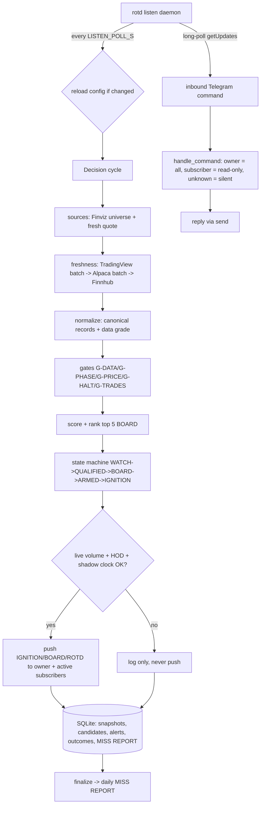

# ROTD — Runner of the Day

**A separate, stricter system that surfaces the few US micro-caps (market cap
≤ `MAX_MARKET_CAP`, default $100M — any share price) most likely to be that
day's explosive runner (+100% or more), as early as the evidence allows — and
stays silent the rest of the time.**

ROTD is decision support only. It places no orders, never shorts, and never
promises a move. It exists because the earlier penny early-warning system
(`penny-early-warning`, read-only reference in this repo) alerts too often and
its data is inconsistent. ROTD fixes that structurally:

- **Rank, then budget** — candidates compete; an alert is a scarce resource spent
  on the day's best name, not a reaction to a per-stock threshold.
- **One snapshot of truth** — every decision reads one reconciled, timestamped
  snapshot per cycle. No module fetches its own data in the decision path.
- **Fail closed** — missing, stale or conflicting data lowers the data-quality
  grade and suppresses alerts. It never becomes a pass.
- **Code counts, model reads** — all numbers, scores and ranks come from code.
  The language model only classifies news and filings, asynchronously, and can
  never raise a score above the rules-only verdict.
- **Daily self-measurement** — a MISS REPORT explains, for every runner the day
  produced, exactly why ROTD did or did not flag it, and how early.

## Install

Download the script and run it **directly** (don't pipe it into bash — it needs
to read your answers from the terminal):

```bash
wget -O install.sh https://raw.githubusercontent.com/Ace1337z/Runner-of-the-Day/main/install.sh
bash install.sh
```

The installer (idempotent, 9 steps):
1. **Credentials first** — asks **only** for your Telegram bot token + chat id
   (hidden input; everything else is a safe default).
2. Installs system packages (python3, venv, pip, wget, tar).
3. Downloads the source tarball into `/opt/rotd`.
4. Creates a venv and installs the package (`pip install -e .[dev]`).
5. Writes `config.env` (mode 600) via `rotd setup --non-interactive`.
6. Auto-detects the Telegram chat id (message the bot, or set it later).
7. Installs + enables a `systemd` service (`deploy/rotd.service`).
8. Runs the offline self-test and the live `doctor` check.
9. Starts the service (`journalctl -u rotd -f` for logs).

Every other API key defaults to empty (safe) and is added **later, from
Telegram itself** — from your configured chat, send:

```
/setkey FINVIZ_TOKEN <token>      # the only key needed to produce candidates
/setkey FINNHUB_KEY <key>         # quote + market status
/setkey ALPHA_VANTAGE_KEY <key>   # global quote
/setkey ALPACA_KEY <id>           # unblocks the batched bid/ask book -> G-SPREAD/G-EXIT
/setkey ALPACA_SECRET <secret>
/setkey AI_BASE_URL <url>         # OpenAI-compatible endpoint for the catalyst auditor
/setkey AI_KEY <key>
/setkey AI_MODEL <model-id>
```

> **⚠️ Set `FINVIZ_TOKEN` immediately after install.** It is the primary feed and
> the **only** source of the micro-cap universe (market cap ≤ `MAX_MARKET_CAP`).
> Until it is set, ROTD pulls nothing, scans return **zero candidates**, and the
> data grade is **F** — that is expected, not a bug. (`/keys` shows what is set;
> the `doctor` check flags `source:finviz: FINVIZ_TOKEN is not set`.) Every other
> key is optional.

`/setkey` writes only those eight allowlisted keys to the config file (mode 600),
refuses anything else, and ignores messages from any chat but the configured
`TELEGRAM_CHAT_ID`. Without any key ROTD still runs in shadow mode and the daily
MISS REPORT lists every gate that was `NOT_ENFORCED` for lack of a feed.

**Non-interactive / headless** (CI, or to pre-seed any key):
```bash
ROTD_NONINTERACTIVE=1 TELEGRAM_TOKEN=... TELEGRAM_CHAT_ID=... \
  FINVIZ_TOKEN=... AI_BASE_URL=... AI_KEY=... AI_MODEL=... \
  ROTD_INSTALL_DIR=/opt/rotd bash install.sh
```
Every exported name that matches a setting in the registry is written to
`config.env`; unknown names are ignored. `ROTD_VERSION` (default `main`, or a
tag) and `ROTD_URL` are also overridable.

**Manual install** (no script): `pip install -e .[dev]`, then
`rotd setup` (prompts for Telegram) or `rotd setup --non-interactive`.
Secrets are never read from the command line and are redacted from logs.

## Updating an existing install

`update.sh` upgrades a running `/opt/rotd` in place. **`config.env`, `rotd.db`
and `logs/` are never touched** — only the code tree, the venv and the systemd
unit are replaced.

```bash
cd /opt/rotd
sudo bash update.sh            # latest main
sudo bash update.sh v1.1.0     # or a tag
```

If the install lives elsewhere:
```bash
ROTD_INSTALL_DIR=/srv/rotd bash update.sh
```

What it does, in order:

1. Backs up the **current code** to a fresh `mktemp -d` directory (the database
   is deliberately excluded — a live `rotd.db` can be tens of GB and copying it
   to `/tmp` would fill the disk).
2. Downloads the tarball for `main` or the tag and stops the `rotd` service.
3. Replaces `src/rotd` wholesale (so modules deleted upstream, such as the
   removed TwelveData adapter, do not linger), then overlays the rest of the
   tree. `config.env`, `rotd.db` and `logs/` stay as they are.
4. Reinstalls dependencies into the existing venv (new dependencies are picked
   up automatically).
5. Re-renders and installs `deploy/rotd.service` (`@USER@`/`@INSTALL_DIR@`
   substituted), then `systemctl daemon-reload`.
6. Runs `rotd selftest` (offline, 53 checks) and `rotd doctor` (live sources,
   model, calendar, disk).
7. Restarts the service and prints the first 12 status lines.
8. If `rotd.db` is larger than 5 GB, prints the one-time reclaim commands.

**Rollback** — the code backup tarball path is printed at the end of the run:
```bash
sudo systemctl stop rotd
sudo tar -C /opt/rotd -xf /tmp/tmp.XXXX/code.tar   # BACKUP path from the update output
sudo systemctl start rotd
```
`config.env` and `rotd.db` were never modified, so no data rollback is needed.

### What changed for an existing install

Nothing in `config.env` has to be edited. Notes for upgrades from the previous
release:

- **`TWELVEDATA_KEY` is gone.** It is ignored if still present. Freshness quotes
  now come from the keyless TradingView scanner, then Alpaca batched quotes,
  then a paced Finnhub call. You can delete the line from `config.env`.
- **`AI_BASE_URL` / `AI_KEY` / `AI_MODEL`** replace any `OPENAI_*` names you may
  have exported by hand. `install.sh` no longer sets `OPENAI_*`.
- **New settings default sanely**, so no action is required:
  `MIN_VOL_3M_SHARES`, `MIN_DVOL_10M_REG/EXT`, `MAX_DRAWDOWN_FROM_HOD_PCT`,
  `RAW_RETENTION_HOURS`, `CAND_RETENTION_HOURS`, `DB_PRUNE_INTERVAL_S`,
  `CAND_JSON_TOP_N`, `MEMORY_TTL_S`, `VOL_HISTORY_RESTORE_MIN`,
  `ALERT_BUDGET_MIN/MAX`, `IGNITION_THRESHOLD`, `ARM_MIN_SCORE`, `ARM_MAX_RANK`,
  `REG_CONFIRM_BARS`, `EXT_CONFIRM_BARS`, `CHASE_CAP_PCT`, `AI_TIMEOUT_S`.
  `rotd config KEY` prints any of them.
- **The database migrates itself** on first start (WAL, indexes, retention
  window, `auto_vacuum`). No manual SQL. The `subscribers` table is created by
  the same migration; existing installs start with an empty guest list, so
  behaviour is unchanged until the owner runs `/addsub`. `seen_users` (added with
  the access-request flow) fills up on its own as people message the bot.

### Reclaiming a bloated database (one time)

The previous release kept every raw payload, every per-cycle candidate row and a
full snapshot per cycle, and grew the DB to tens of GB in two days. Now only the
top `CAND_JSON_TOP_N` ranked names are persisted at all (one **overwrite** row
per symbol, not one per 5-second tick), retention is 2h for raw payloads,
candidates/decisions and snapshots, and the prune + incremental-vacuum pass runs
every 5 minutes (`DB_PRUNE_INTERVAL_S=300`) so `rotd.db` stays small.

Deleting rows does **not** shrink the file on a legacy DB: `auto_vacuum` only
takes effect on a new file or after a full `VACUUM`, and a full `VACUUM` needs
about twice the file size free. Pick one:

```bash
# A. Enough free disk (>= ~2.2x the file size):
sudo systemctl stop rotd
sqlite3 /opt/rotd/rotd.db 'VACUUM'
sudo systemctl start rotd

# B. Not enough free disk: start a fresh DB. History is lost; the runner list,
#    MISS REPORT and shadow clock for previous days are gone with it.
sudo systemctl stop rotd
sudo mv /opt/rotd/rotd.db /opt/rotd/rotd.db.old
sudo systemctl start rotd          # creates a compact DB with auto_vacuum on
sudo rm /opt/rotd/rotd.db.old      # after you are satisfied
```

`rotd doctor` reports the DB path and disk headroom; `update.sh` prints the
commands above whenever it finds a file over 5 GB.

## Status

Built and running in shadow. At most `ALERT_BUDGET_PER_DAY` (5, +1 reserve)
ignition alerts per trading day; zero alerts on a quiet day is a correct outcome.
The budget is adjustable live with `/setbudget N` (1–10) and resettable with
`/resetbudget`.

**Shadow mode is the default gate.** ROTD must run for a full **10-trading-day
shadow clock** before a single live push is allowed. The clock counts actual NYSE
sessions (weekends and holidays do not advance it), is stored in the database, and
survives restarts. A live `rotd run` refuses to push until the clock completes.
See `docs/DECISIONS.md` and the `shadow_clock` row in `rotd doctor`.

## Quickstart

```bash
rotd doctor          # check config, sources, calendar, shadow clock
rotd selftest        # offline self-test (no network)
rotd setup           # write config (prompts for Telegram; idempotent)
rotd detect-chat     # auto-fill TELEGRAM_CHAT_ID from a bot message
rotd shadow-start    # start the 10-trading-day shadow clock
rotd shadow          # run every decision, push nothing
rotd shadow-status   # how far the clock has come
rotd finalize        # end of day: runner list + MISS REPORT
rotd miss            # print the MISS REPORT for a day
rotd status          # current day, state machine, budget used
rotd replay DATE     # re-run a stored day through the same code
rotd subs            # list Telegram subscribers and days left
```

## How it works

ROTD runs on a **cycle** driven by the US equity-session calendar
(`calendar_us.py`, backed by `exchange_calendars`). Each trading day is split
into phases — `PRE`, `OPEN` (front side), `MIDDAY`, `POST` (after hours);
`OVERNIGHT` is a closed state that never ignites. The clock decides the phase and
is what makes "as early as the evidence allows" precise rather than a guess.

A cycle:

1. **Universe** — `sources/finviz.py` pulls the whole micro-cap US universe
   (Elite screener, full column set — the column-id mapping is verified in
   `docs/VERIFIED.md` G-17). Finviz is also the only extended-hours price source
   on this deployment.
2. **Reconcile** — `normalize.py` turns every raw row into one canonical record
   per symbol with a reason-coded price basis (`REGULAR` vs `EXTENDED`), a data
   grade (`A`–`F`), and staleness/conflict flags. Conflicting or stale quotes are
   dropped, never averaged silently. `float_shares` is normalized to a single
   unit (shares) at this boundary, so a millions-vs-shares feed cannot distort
   FUEL.
3. **Freshness** — `runtime._fresh_quotes` upgrades the tracked pool (board and
   near-board) with, in order: one keyless TradingView batch POST, one Alpaca
   batched quote call, one paced Finnhub quote. Every step fails soft to the
   reconciled Finviz price.
4. **Features** — `features.py` derives the five scoring inputs (tape, momentum,
   catalyst, gap, context) plus rolling 3m/10m volume deltas, a rolling VWAP,
   float rotation and drawdown-from-HOD, fed in by the in-memory tracker.
5. **Gates** — `gates.py` runs hard, fail-closed gates before any scoring:
   `G-DATA` (grade/stale/halt), `G-PHASE` (market state), `G-PRICE` (market cap /
   legacy price ceiling, no floor), `G-HALT`, `G-TRADES`. Three gates that need a
   feed this deployment does not have — `G-SPREAD` (bid/ask book), `G-LIQ`
   (15-min bar feed), `G-EXIT` (slippage estimate) — are **off by default** and
   report `NOT_ENFORCED` (they re-arm if you add a book/bar feed; see
   `docs/VERIFIED.md` G-18). A name that fails any enforced gate is not scored
   and cannot alert.
6. **Score & rank** — `scoring.py` computes a 0–100 Stage-1 score from five
   weighted components, ranks candidates, and takes the `BOARD_SIZE` (5) top
   names. Rank 1 becomes ROTD only if its score clears `ROTD_MIN_SCORE` (60).
   The score is deliberately uncalibrated — it is an ordering, not a probability.
   Weights are renormalized over the components that actually have data, so a
   missing optional input lowers confidence instead of silently capping the score.
7. **State machine** — `state_machine.py` runs each board name through a ladder
   `WATCH → QUALIFIED → BOARD → ARMED → IGNITION`, spending the day's alert
   budget on the best-confirmed name. Transitions are reversible and every step
   stores a reason.
8. **Catalyst** — `catalyst.py` runs the methodology_v3 auditor (`auditor.py`)
   against a news/filings bundle, asynchronously. The model classifies and
   audits only; it can never exceed the rules-only verdict, and on timeout, no
   model, or malformed output it fails closed to rules-only.
9. **Explain & record** — `notifier.py` renders the board, ROTD pick, ignition,
   and the daily MISS REPORT. Every score, gate and suppression carries reason
   codes. `store.py` persists snapshots, candidates, alerts, outcomes,
   runner lists and the MISS REPORT to SQLite so any day can be replayed.

### The hard live-volume gate

Whole-day volume is not evidence that a stock is moving *now*. A name that ran at
09:35 and died can still carry a large daily total. Both the `BOARD → ARMED` and
`ARMED → IGNITION` steps therefore require live tape:

| Check | Setting | Default | Fails with |
| --- | --- | --- | --- |
| Shares traded in the last 3 minutes | `MIN_VOL_3M_SHARES` | 25,000 | `RECENT_VOL_TOO_LOW` |
| 10-minute dollar volume, OPEN/MIDDAY | `MIN_DVOL_10M_REG` | $75,000 | `DVOL_10M_TOO_LOW` |
| 10-minute dollar volume, PRE/POST | `MIN_DVOL_10M_EXT` | $25,000 | `DVOL_10M_TOO_LOW` |
| No rolling history yet (warmup) | — | — | `NO_VOL_HISTORY` |
| 10m roll unusable at 4:00 AM | falls back to 3-minute tape ×2, floor still applies | — | — |

The check **fails closed**: warmup (no history) is a failure, not a pass, so the
first cycles after a restart cannot arm a name on unknown tape. Warm boot
(see below) is what keeps that window short.

The one exception is the **10-minute dollar volume at the 4:00 AM open**. The
10-minute figure is a rolling delta, so on the first candles it is `None` (the
deque is too shallow) or `0.0` (no earlier sample to subtract). Failing closed
on that gap stalled valid pre-market gappers for the full 10 minutes, so when
the delta is unusable the dollar volume is estimated from the already-vetted
3-minute tape at a conservative ×2 (the truthful ratio is ~3.33×). A name must
still out-trade a floor twice its own 3-minute dollars, and the session floor
still applies: the fallback changes how the input is measured, never whether a
floor is enforced.

### Warm boot

A restart used to lose every in-memory rolling window, leaving the volume gate
blind for its first three minutes and the board empty. On start, `runtime`
rehydrates from today's snapshots:

- rolling cumulative volume and price history for the last
  `VOL_HISTORY_RESTORE_MIN` (15) minutes, from which 3m/10m deltas and the
  rolling VWAP are recomputed exactly as a live cycle would;
- the current `BOARD`/`ARMED` states from the latest decision per symbol;
- the alert budget already spent today from `alerts`.

Restored `ARMED` names restart their confirmation window (`confirm_bars = 0`);
the armed *level* is not persisted, so a restart can never ignite a name on a
price it has not re-confirmed.

Snapshots store only the tracked pool's `quality_json["volumes"]` /
`["prices"]`, not the whole universe, and are pruned after 2h.

### Front-side only: rolling VWAP and drawdown from HOD

ROTD buys strength, not fades. Two mechanisms enforce that:

- **Rolling VWAP** (`ABORT_VWAP_MINUTES`, 5m) — a 5-minute close under the alert
  VWAP aborts a live alert (`ABORT_VWAP`).
- **Drawdown from HOD** (`MAX_DRAWDOWN_FROM_HOD_PCT`, 15%) — a price more than
  15% below the day high blocks `ARMED → IGNITION` (`BACKSIDE_OF_HOD`) and
  proportionally penalizes the STRUCTURE component (a drawdown at/above the
  threshold scores ZERO), so a +80%-then-−35% chart cannot rank on old strength.
- **Minimum structure score** (`MIN_STRUCTURE_SCORE`, 2.0/15) — a heavy-tape name
  with a weak front-side chart cannot reach ARMED (`ARM_STRUCTURE_TOO_LOW`), and it
  steps back out mid-confirmation if its chart rolls over
  (`ARM_STEP_DOWN_STRUCTURE`), so volume/fuel can never carry a dying double-top
  into an alert.

**Float rotation** (volume ÷ free float) feeds both TAPE and FUEL: a name that
has turned over its float is real demand, not just a gap.

### POST: the after-hours move, not the morning's

In `POST`, the price line, TAPE and STRUCTURE use the **extended-hours change
against today's 16:00 ET close** (`ah_change_pct`) when the feed supplies it, so
a 10:00 AM regular-session spike cannot carry an after-hours alert. The alert
prints both numbers:

```
Price $3.42 (+2.5% AH | +20.8% vs prev close)
```

### Shadow clock (Phase 6)

`shadow.py` is a calendar-bound, 10-trading-day gate. Each cycle calls
`shadow.note_cycle`; the clock advances only on real NYSE sessions. Until it
completes, `rotd run` refuses to push (`exit 3`) and logs the reason. This is
the default safety gate — ROTD proves itself silent-when-wrong before it can
speak.

## Architecture

`rotd listen` is the long-running process. The Telegram command poll runs on the
**main thread** (so a message is answered within ~`LISTEN_POLL_S` at most), while
the heavy decision **cycle** runs on a **worker thread** — a cycle can take many
seconds (Finviz scrape, optional catalyst LLM call up to `CATALYST_TIMEOUT_S=45s`),
and it must never sit in front of a user command. Each pass: (1) short-poll
`getUpdates` and reply, (2) start the cycle off-thread, (3) short-poll again so a
command sent *during* a cycle is still answered promptly, (4) sleep the rest of
the interval and reload `config.env` if it changed. `run`/`shadow` remain one-shot
manual commands; `listen` is what the systemd unit runs.

> **Responsiveness:** send "typing…" before each reply and poll twice per tick, so
> commands are never blocked behind a cycle. Set `SHADOW_RUN_WHEN_CLOSED=0` to stop
> running cycles outside NYSE sessions (commands are still answered instantly).

> **Runner / MISS reporting:** the daemon auto-finalizes at end of day — it builds the
> runner list and the daily MISS REPORT and pushes it to Telegram (no cron needed).
> `/miss` reads it; `rotd finalize [YYYY-MM-DD]` rebuilds it on demand. A name that
> "ran" but ROTD never alerted shows up in the MISS REPORT as a *missed* runner with
> the reason it was gated (e.g. `G-DATA=STALE`), rather than being silently dropped.
> A daemon started on a weekend or holiday finalizes the last *completed* session
> (e.g. Friday), never the upcoming one.



### Long-running service

`deploy/rotd.service` runs `rotd listen` with:

- `StartLimitIntervalSec=60` / `StartLimitBurst=3` in `[Unit]` (modern systemd
  rejects these in `[Service]`) — a crash loop panics out after 3 restarts in
  60s instead of restarting forever;
- `Restart=always`, `RestartSec=5`;
- `NoNewPrivileges`, `PrivateTmp`, `ProtectSystem=full`, `ProtectHome=read-only`
  and `ReadWritePaths=@INSTALL_DIR@` — the process needs outbound HTTPS and its
  own directory, nothing else.

Memory is bounded in-process rather than by the unit: per-symbol dictionaries
(feature history, volume history, catalyst items) are evicted after
`MEMORY_TTL_S` (2h) out of the active universe, snapshots keep only the tracked
pool, and candidate rows store full gate/feature JSON only for the top
`CAND_JSON_TOP_N` (50) names.

### What an alert looks like

All messages are rendered by `notifier.py` from the decision object — never
from model prose. Times show **ET** and **KL** (Asia/Kuala Lumpur) for the owner.

**IGNITION** (spends the budget; the one alert that pushes live):
```
🚨 ROTD IGNITION — $ABCD
2026-10-14 09:35:02 ET / 21:35 KL  |  mode OPEN  |  slot R1

Score 84/100  (rank 1)
Price $3.42  (+6.2% vs prev close)
Spread 0.6%   Vol 8.4M   Dollar-vol $28.7M
3m Vol 412K   10m Dollar-Vol $6.1M
Float 42M   Short 12.0%

Why now:
  TAPE       30.0/30
  CATALYST   21.0/25
  FUEL       17.0/20
  STRUCTURE  11.0/15
  CONTEXT     5.0/10
Flags: ARMED_OK, BOARD_HELD

Risk: this is decision support, not advice; runners reverse hard.
```

In `POST` the price line and the tape line carry the extended-hours move:

```
Price $3.42  (+2.5% AH | +20.8% vs prev close)
```

**BOARD** (silent, scheduled in `BOARD_SCHEDULE_ET`):
```
📋 ROTD BOARD — top 5
2026-10-14 09:35:02 ET / 21:35 KL  |  mode OPEN  |  data B

  1. $ABCD   84.0        $3.42   +6.2%
  2. $ZXYZ   70.0        $0.88   +3.1%
```

**ABORT** (a fired alert that no longer holds):
```
⚠️ ROTD ABORT — $ABCD
2026-10-14 09:52:10 ET / 21:52 KL  |  reason ABORT_VWAP
price fell 5m below the alert VWAP; ignition condition no longer holds
Price now $3.21
```

**ROTD** (the day's qualified rank-1 pick, end of day):
```
🏆 ROTD — $ABCD
2026-10-14 09:35:02 ET / 21:35 KL  |  score 84/100
Price $3.42  (+6.2%)
```

**MISS REPORT** (always produced and pushed automatically at session close, even on
a zero-alert day; `/miss` reads the latest one, `rotd finalize [YYYY-MM-DD]` rebuilds it):
```
📊 ROTD MISS REPORT — 2026-10-14
alerts 1  |  runners in list 3  |  caught 1  |  missed 2
Data grade for the day: B  (mean B)
Caught:
  ✓ $ABCD lead 12m  max +9.4%
Missed:
  ✗ $WXYZ +140% — no fresh quote (G-DATA=STALE)
Quiet day: no names ran, and ROTD stayed silent. That is a correct outcome, not a failure.
```

### Telegram commands

Access is two-tier. `TELEGRAM_CHAT_ID` is the **owner** and keeps every command.
Chat ids in the `subscribers` table get the **read-only** set and receive every
alert. Anyone else is ignored silently — no reply, no "denied", nothing to
enumerate.

| Command | Owner | Subscriber | What it does |
| --- | :---: | :---: | --- |
| `/start`, `/help` | ✓ | ✓ | Show the command menu (the subscriber menu lists only the read-only set) |
| `/status` | ✓ | ✓ | Now, session mode, shadow clock, alert budget used |
| `/board` | ✓ | ✓ | The latest ranked board (top candidates) |
| `/runners` | ✓ | ✓ | Today's runner list (big movers) |
| `/miss` | ✓ | ✓ | Today's MISS REPORT (auto-built at session close; the honest "which names ran and why ROTD did/didn't flag them") |
| `/alerts` | ✓ | ✓ | Today's ignition alerts |
| `/setkey KEY VALUE` | ✓ | — | Set one of the 8 allowlisted keys after install (secrets saved, not echoed) |
| `/setbudget N` | ✓ | — | Set the daily IGNITION budget (1–10). Persisted and applied immediately, no restart |
| `/resetbudget` | ✓ | — | Clear today's spent IGNITION slots — deletes today's `IGNITION` rows and resets the in-memory budget to `0/N` |
| `/keys` | ✓ | — | Show which API keys are set vs missing |
| `/addsub CHAT_ID\|@username DAYS [LABEL]` | ✓ | — | Grant or renew a subscription; expiry is today + DAYS. An `@username` that never opened the bot is pre-registered and links on their `/start` |
| `/rmsub CHAT_ID\|@username` | ✓ | — | Revoke a subscription immediately |
| `/checksubs` | ✓ | — | List every subscriber with status and days left (`/subs` is an alias) |
| `/request` | ✓ | ✓ | Ask the owner for access (also the 🔑 button on `/start`) |
| `/broadcast MESSAGE` | ✓ | — | Send an announcement to the owner and every active subscriber, then report `Delivered to N chat(s) (M failed)` |
| `/shadow-start [YYYY-MM-DD]` | ✓ | — | Start the 10-trading-day shadow clock (`--force` restarts) |
| `/shadow` | ✓ | — | The 10-trading-day shadow clock |
| `/setup` | ✓ | — | Points at the host installer (`/setup` cannot run on the host from Telegram) |
| `/log` | ✓ | — | Recent event log |
| `/doctor` | ✓ | — | Live checker hint (run `rotd doctor` for the full report) |

A subscriber command that is not in the read-only set answers `Unauthorized.`;
the owner is never refused. An expired subscriber gets exactly one line for a
read-only command and nothing else:

```
⚠️ Your subscription expired on 2026-10-15. Contact admin to renew.
```

Admin commands from a lapsed chat still answer `Unauthorized.` (the expiry date
is not shown for a command they could never run).

### Subscribers (time-bound read-only access)

The owner can hand out temporary access — friends, clients, a trial — without
giving away the keys or the budget. Subscribers receive every outbound message
(IGNITION, BOARD, ABORT, ROTD, MISS REPORT) and can run the read-only commands.
They cannot change a key, the budget, or the shadow clock.

Storage is a table in the same `rotd.db`:

```sql
CREATE TABLE IF NOT EXISTS subscribers (
    chat_id TEXT PRIMARY KEY,
    expires_at TEXT NOT NULL,  -- ISO date 'YYYY-MM-DD' (UTC)
    label TEXT DEFAULT '',
    created_at TEXT NOT NULL
);
```

From Telegram (owner only):

```
/addsub 123456789 30 Dave      # ✅ Subscriber 123456789 (Dave) activated for 30 days (expires 2026-11-17). Welcome playbook delivered.
/addsub @edogen 30            # resolves via seen_users; pre-registers if they never opened the bot
/checksubs                     # 👥 ROTD Subscribers List: … Total Active: 1 | Total Registered: 2
/rmsub @edogen                 # 🗑️ Subscriber 123456789 removed.
/broadcast market closes 13:00 # 📢 Broadcast sent! Delivered to 4 chat(s) (0 failed).
```

### Access requests (self-service)

Telegram will not let a bot open a DM from an `@username`; the numeric `chat_id`
is required. Every message and button tap is therefore recorded in `seen_users`,
which makes `@username` resolvable afterwards.

A stranger who sends `/start` gets a 🔑 Request Access button (or types
`/request`). That marks them `PENDING` and DMs the owner their name, handle and
chat id with one-click `30 / 60 / 90 days` and `Reject` buttons. Approving adds
the subscriber row, marks them `APPROVED`, and immediately delivers the welcome
playbook. A second tap is ignored (`already pending`); a rejected chat gets no
further response.

If the owner runs `/addsub @someone 30` before that user ever messaged the bot,
a placeholder `@someone` row is stored; the user's first `/start` migrates it to
their numeric id and delivers the playbook automatically.

`/checksubs` shows every row (active and expired) with exact days left.

### Expiry reminders (T-7 / T-3 / T-1 / T-0)

The listen daemon checks for expiring subscribers on startup and hourly. A
subscriber is DM'd exactly **once** per milestone, on the exact day their
`days_left` hits it:

| Days left | Message | Button |
| ---: | --- | --- |
| 7 | ⏳ ROTD Subscription Notice — expires `{expiry_date}` | Renew Now |
| 3 | ⚠️ 3 Days Left on ROTD Access | Extend My Access |
| 1 | 🚨 Final Warning: Expires Tomorrow | Renew Immediately |
| 0 | ❌ Subscription Expired — live alerts paused | Reactivate Now |

Every message carries one inline URL button pointing at `RENEW_URL`. When
`RENEW_URL` is empty the message still sends, as plain text with no button (a
button that goes nowhere is worse than none). Reminders are **per-user DMs**,
never a fan-out to the whole subscriber list, and the owner chat is never a
recipient.

Dedup lives in its own table so a crash, a restart, or an hourly pass can never
double-send. A milestone is recorded **only after a successful send**, so a
blocked chat is retried on the next pass instead of being skipped forever:

```sql
CREATE TABLE IF NOT EXISTS expiry_reminders_sent (
    chat_id    TEXT NOT NULL,
    milestone  INTEGER NOT NULL,   -- 7, 3, 1, 0 (days left when sent)
    expires_at TEXT NOT NULL,      -- the expiry this reminder belonged to
    sent_at    TEXT NOT NULL,
    PRIMARY KEY (chat_id, milestone, expires_at)
);
```

Keying on `(chat_id, milestone, expires_at)` means a **renewal starts a fresh
cadence**: the new expiry has its own T-7/T-3/T-1/T-0 rows, so a subscriber who
renews and later lapses again is reminded again. Pre-registered `@username`
placeholders (no numeric id yet) and malformed expiry dates are skipped.

Turn it off with `EXPIRY_REMINDERS=0`. `EXPIRY_REMINDER_INTERVAL_S` only
controls how promptly the daemon notices a due milestone — the cadence itself is
date-based, so a longer interval delays a reminder within the day but never
skips one.

`/addsub` immediately pushes the welcome playbook (how to trade an IGNITION:
pullback vs HOD breakout, VWAP stop, scaling out, ABORT handling) to the new
chat. If the bot has never been messaged by that chat it cannot open the DM;
the subscription is still saved and the owner is told the playbook will arrive
on the user's first `/start`. Active subscribers get the same playbook from
`/start` and `/help` (with their remaining days), so it can never be lost.
`/addsub` and `/broadcast` are messages the owner typed, so they send even while
`SHADOW=1`; shadow suppresses automated decision pushes, not commands.

Or from the host, which is the same table and the same rules (the CLI path does
not DM the playbook — it arrives on the user's first `/start`):

```
rotd subs                                  # list
rotd subs add 123456789 30 Dave            # add or renew
rotd subs rm 123456789                     # revoke now
```

Expiry is checked on **every** message and every broadcast with
`date('now') <= expires_at`, so a lapsed row stops receiving alerts the moment
the UTC date passes — no restart, no cron. Renewing an existing chat id just
moves the date forward; the label is kept unless a new one is given.

Delivery is per recipient: if one subscriber blocks the bot or their chat id is
wrong, the failure is logged as a warning and every other recipient still gets
the message. The owner's copy is never dropped because of a subscriber.

To add a source after install, e.g. the only key that makes ROTD produce
candidates:
```
/setkey FINVIZ_TOKEN <token>
/keys
```
Changes apply on the next cycle (the `listen` loop reloads `config.env`).
`/setbudget` and `/resetbudget` take effect on the running process immediately.

### Slash-command menu

Telegram's `/` autocomplete is **per bot token**, not per process — so a sibling
system sharing the same token (e.g. `penny-early-warning`) will show its commands
unless ROTD claims the menu. ROTD re-asserts its own menu:

- **at startup** (once per `listen` run), and
- **on every `/start`** (so a menu clobbered by the sibling self-heals).

Command names are sanitized to Bot API rules (single-word, lowercase); a single
invalid name makes the whole `setMyCommands` call fail silently, which is how the
sibling's menu can otherwise win. To inspect or force it:

```bash
rotd telegram-menu --show          # what Telegram currently advertises
rotd telegram-menu --show --check  # exit non-zero if it differs from ROTD's
rotd telegram-menu                 # publish ROTD's commands now
```

`rotd telegram-check` also claims the menu during install (`--no-menu` to skip).

## Complete profile

Every threshold is a **named setting** in `config.py` with a unit, a starting
value and a one-line rationale — no magic numbers in code. `tests/test_config.py`
fails if any setting lacks a unit or rationale, or is referenced but missing.
Inspect any value with `rotd config KEY`. The full registry is below, grouped by
purpose. Secrets (`secret=True`) are never displayed or logged.

### Config file & keys
- Location: `$HOME/.rotd/rotd.env` (owner-only, mode 600 on POSIX / ACL on Windows),
  gitignored. Override with `ROTD_CONFIG` or `--config`. The installer sets
  `ROTD_HOME=/opt/rotd` and puts the config, DB and logs there.
- At install only `TELEGRAM_TOKEN` + `TELEGRAM_CHAT_ID` are asked for. Add the
  rest later from Telegram via `/setkey KEY VALUE` (8 allowlisted keys), or
  pre-seed them through the environment in non-interactive mode.
- Secrets never travel on the command line and are scrubbed from logs.

| Setting | Default | Unit | Meaning |
|---|---|---|---|
| `ROTD_HOME` | (empty) | path | Install home; anchors the DB, config and logs. |
| `FINVIZ_TOKEN` ★ | (empty) | — | Finviz Elite token — the only key required to run. |
| `FINVIZ_BASE` | `https://elite.finviz.com` | url | Finviz base URL. |
| `FINNHUB_KEY` ★ | (empty) | — | Finnhub key (quote + market status). |
| `ALPHA_VANTAGE_KEY` ★ | (empty) | — | Alpha Vantage key (global quote). |
| `ALPACA_KEY` ★ / `ALPACA_SECRET` ★ | (empty) | — | Alpaca key id / secret — unblocks the batched bid/ask book. |
| `ALPACA_FEED` | `iex` | feed | Alpaca data feed (iex = single venue). |
| `SEC_USER_AGENT` | `ROTD research` | text | SEC EDGAR requires a descriptive User-Agent. |
| `AI_BASE_URL` | (empty) | url | OpenAI-compatible base URL for the catalyst auditor. |
| `AI_KEY` ★ | (empty) | — | Catalyst model API key (rules-only if empty). |
| `AI_MODEL` | `deepseek-v4.1-flash` | model | Catalyst model id. |
| `TELEGRAM_TOKEN` ★ | (empty) | — | Telegram bot token (asked at install). |
| `TELEGRAM_CHAT_ID` | (empty) | — | The only chat allowed to read/command (asked at install). |
| `RENEW_URL` | (empty) | url | Renewal/payment link on every expiry reminder (empty = plain-text reminders, no button). |
★ = secret (never displayed / logged).

### Universe & scope
| Setting | Default | Unit | Meaning |
|---|---|---|---|
| `MAX_PRICE` | `10.00` | USD | Legacy price ceiling, used only when `MAX_MARKET_CAP=0`. **No price floor.** |
| `MAX_MARKET_CAP` | `100000000` | USD | Universe ceiling: market cap ≤ this, any share price (high-priced micro-caps qualify). `0` = disabled. |
| `INCLUDE_OTC` | `0` | bool | OTC off — poorer data, different rules. |
| `INCLUDE_DERIVATIVES` | `0` | bool | Warrants/rights/units excluded. |
| `PRICE_BANDS` | `0.20,0.50,1,5,10` | USD bounds | Tier boundaries for metric / MISS breakdowns. |
| `SYMPATHY_ENABLED` | `0` | bool | Sector-sympathy adds off until proven. |
| `CARRY_LOOKBACK_D` | `90` | days | Carry-list "recent runner" window. |

### Data reconciliation (`DATA-01..12`)
| Setting | Default | Unit | Meaning |
|---|---|---|---|
| `PRICE_CONFLICT_PCT_REG` | `50.0` | % | Two sources >50% apart in regular hours ⇒ CONFLICT. Wide on purpose: micro-caps jump +20-30% in seconds and helper feeds lag. |
| `PRICE_CONFLICT_PCT_EXT` | `95.0` | % | Extended hours: same check, wider tolerance. Measured relative to the higher price, so it is bounded below 100% — a value ≥ 100 disables the gate. |
| `QUOTE_MAX_AGE_S_REG` | `20` | s | A regular-hours quote older than this is STALE. |
| `QUOTE_MAX_AGE_S_EXT` | `60` | s | An extended-hours quote older than this is STALE. |
| `BAR_MAX_AGE_S` | `90` | s | A bar series whose last bar is older than this is STALE. |
| `FLOAT_CONFLICT_FACTOR` | `1.5` | x | Two float sources >1.5× apart ⇒ FLOAT_CONFLICT. |
| `SEC_SHARES_MAX_AGE_D` | `14` | days | Shares older than this can't bound float. |
| `REVERSE_SPLIT_RECENT_D` | `90` | days | A recent reverse split flags REVERSE_SPLIT_RECENT. |

### Live-volume gate & front-side structure
| Setting | Default | Unit | Meaning |
|---|---|---|---|
| `MIN_VOL_3M_SHARES` | `50000` | shares | Minimum shares traded in the last 3 minutes (rolling in-memory delta). Blocks ARMED/IGNITION on dead tape; warmup also fails closed. |
| `MIN_DVOL_10M_REG` | `150000` | USD | Minimum 10-minute rolling dollar volume in OPEN/MIDDAY. |
| `MIN_DVOL_10M_EXT` | `75000` | USD | Minimum 10-minute rolling dollar volume in PRE/POST. |
| `MAX_DRAWDOWN_FROM_HOD_PCT` | `15.0` | % | Block ARMED→IGNITION when price is more than this below the day high; a drawdown at/over this zeroes the structure sub-score. |
| `MIN_STRUCTURE_SCORE` | `2.0` | points | Minimum weighted STRUCTURE points (of 15) required to reach (and hold) ARMED. |

### Gates (fail-closed; run before scoring)
| Gate | Enforced? | Needs | Default setting |
|---|---|---|---|
| `G-PRICE` | ✅ always | `MAX_MARKET_CAP` / `MAX_PRICE` | market cap ceiling, no price floor |
| `G-PHASE` | ✅ always | mode profile | OVERNIGHT never ignites |
| `G-DATA` | ✅ always | fresh, conflict-free grade | drops stale/suspended/conflicting |
| `G-HALT` | ✅ always | quote presence | no halt feed ⇒ defers to G-DATA (`HALT_UNKNOWN`) |
| `G-TRADES` | ✅ always (passes) | trade-count | `MIN_TRADES_15M=0`, `MIN_AVG_TRADE=0` ⇒ NOT_ENFORCED |
| `G-SPREAD` | ❌ OFF (G-18) | bid/ask book | `USE_SPREAD_GATE=0` ⇒ NOT_ENFORCED |
| `G-LIQ` | ❌ OFF (G-18) | 15-min bar feed | `USE_LIQ_GATE=0` ⇒ NOT_ENFORCED |
| `G-EXIT` | ❌ OFF (G-18) | bid/ask book | `USE_EXIT_GATE=0` ⇒ NOT_ENFORCED |

OFF-by-default gates re-arm the moment a feed supplies their input (e.g. set
`USE_SPREAD_GATE=1` / `USE_EXIT_GATE=1` once Alpaca keys are live). A name that
fails **any enforced** gate is not scored and cannot alert. The live-volume gate
is not one of these: it is always enforced in the state machine.

| Gate param | Default | Unit | Meaning |
|---|---|---|---|
| `EXT_SPREAD_MULT` | `1.5` | x | POST/PRE spreads looser by 1.5×. |
| `SPREAD_TIERS` | `1.00:1.5,0.50:3,0.20:5,0.05:8,0.00:12` | price:max% | Max spread by price tier (loosest at the bottom). |
| `LIQ_15M_POST` / `LIQ_15M_PRE` | `25000` | USD | 15-min dollar-volume floor in POST / PRE. |
| `LIQ_15M_OPEN` | `100000` | USD | 15-min floor in OPEN. |
| `LIQ_15M_MIDDAY` | `75000` | USD | 15-min floor in MIDDAY. |
| `MIN_TRADES_15M` / `MIN_AVG_TRADE` | `0` | prints / USD | Trade-count gates; 0 = not enforced. |
| `EXIT_TEST_USD` | `500` | USD | Test exit size for G-EXIT. |
| `EXIT_MAX_SEC` | `60` | s | Test exit must fill within this. |
| `EXIT_MAX_SLIP_PCT` | `2.0` | % | Test exit slippage limit. |

### Scoring (0–100, uncalibrated ordering)
| Setting | Default | Unit | Meaning |
|---|---|---|---|
| `W_TAPE` | `30` | points | Tape-ignition weight. |
| `W_CATALYST` | `5` | points | Catalyst weight. Small on purpose: the LLM catalyst number is noisy, so a low reading must not anchor a pure momentum runner below `ARM_MIN_SCORE`. |
| `W_FUEL` | `20` | points | Fuel weight. |
| `W_STRUCTURE` | `15` | points | Structure weight. |
| `W_CONTEXT` | `10` | points | Context weight. |

The defaults sum to an **80-point raw scale** (30 + 5 + 20 + 15 + 10), rescaled
to 0..100 at scoring time, so the thresholds below are unchanged by the catalyst
weight.

Components with no data are excluded from the weighted average and the remaining
weights are renormalized (active-weight scaling); a missing optional input cannot
silently cap the score.

### Ranking, board & state machine (hysteresis)
| Setting | Default | Unit | Meaning |
|---|---|---|---|
| `BOARD_SIZE` | `5` | names | BOARD = top 5 qualified candidates. |
| `ROTD_MIN_SCORE` | `60` | points | Rank 1 is only ROTD if score ≥ this. |
| `QUALIFY_CONSEC` | `1` | cycles | Consecutive fully-gated cycles to reach QUALIFIED (Candle-1: first candle can qualify). |
| `BOARD_MIN_DWELL_S` | `15` | s | Must stay top-5 this long to hold BOARD. |
| `BOARD_EXIT_RANK` | `8` | rank | Leaves BOARD only below this rank. |
| `ARM_MAX_RANK` | `3` | rank | ARMED requires rank ≤ this. |
| `ARM_MIN_SCORE` | `70` | points | ARMED requires score ≥ this. |
| `IGNITION_THRESHOLD` | `70` | points | ARMED keeps its confirmation only while score ≥ this (last gate before IGNITION — the alert trigger). Must stay ≥ `ARM_MIN_SCORE` so a name cannot arm at one score and fire on a weaker one. |
| `CHASE_CAP_PCT` | `18.0` | % | No ignition if price is >this% above the armed level. |
| `VWAP_IGNITION_TOLERANCE_PCT` | `0.5` | % | Ignition tolerates a wick this far **below** VWAP (a retest of VWAP support) instead of aborting on a strict `price < vwap` test. |
| `MIDDAY_MIN_TAPE_RAW` | `0.72` | 0..1 | MIDDAY only: the TAPE component must reach this raw score to ignite, so a slow 2-hour stair-step grind cannot ride maxed FUEL/STRUCTURE/CONTEXT to an alert. `0` disables it. |
| `EXT_CONFIRM_BARS` | `1` | bars | POST/PRE need this many confirming extended bars. |
| `REG_CONFIRM_BARS` | `1` | bars | Regular hours need this many confirming bars. |
| `HALT_RESUME_EVAL_MIN` | `2` | minutes | Evaluate a resumption for this long after a halt. |

Ladder: `WATCH → QUALIFIED → BOARD → ARMED → IGNITION`. Transitions are
reversible and every step stores a reason.

**Fail-closed arming.** ARMED means "top name *right now*". While a name waits for
its confirmation bars, rank (`≤ ARM_MAX_RANK`), score (`≥ ARM_MIN_SCORE`, then
`≥ IGNITION_THRESHOLD` for the final confirmation), structure
(`≥ MIN_STRUCTURE_SCORE`), live volume and drawdown-from-HOD are
re-checked every cycle. If any of
them slips — it loses the top rank to a competitor, its score falls during
confirmation, its tape dies, or it fades off the high — it steps back down (to
`BOARD`, or `QUALIFIED` if it also left the board) and its confirmation counter
resets, so it cannot ignite on stale strength. Re-arming starts the confirmation
window over.

### Alert budget (scarcity)
| Setting | Default | Unit | Meaning |
|---|---|---|---|
| `ALERT_BUDGET_PER_DAY` | `30` | pushes | Max IGNITION pushes per trading day. Change live via `/setbudget N`. |
| `ALERT_BUDGET_MIN` / `ALERT_BUDGET_MAX` | `1` / `50` | pushes | Accepted range for `/setbudget` (0 would silence the day; 50 caps a typo). |
| `RESERVE_SLOTS` | `1` | pushes | Reserve pushes beyond budget for exceptional names. |
| `EXCEPTIONAL_SCORE` | `90` | points | A reserve candidate must score at least this. |
| `ALERT_MIN_GAP_MIN` | `15` | minutes | Minimum spacing between pushes. |
| `BOARD_SCHEDULE_ET` | `16:30,19:30,04:30,07:30,09:00,09:35` | HH:MM ET | Silent scheduled BOARD messages. |

The budget is also restored after a restart from today's `alerts` rows, so a
crash cannot hand out extra slots. `/resetbudget` deletes today's `IGNITION`
alerts and resets the in-memory counter — use it deliberately, it is a manual
override of the scarcity rule.

### Abort / risk control
| Setting | Default | Unit | Meaning |
|---|---|---|---|
| `ABORT_VWAP_MINUTES` | `5` | minutes | A 5-min close under alert VWAP aborts. |
| `ABORT_SPREAD_WIDE_S` | `300` | s | A wide spread this long aborts. |
| `MIN_RR` | `2.0` | ratio | Min risk:reward; below this downgrades to ARMED. |

### Tracking, grading & the runner list (MISS REPORT input)
| Setting | Default | Unit | Meaning |
|---|---|---|---|
| `CHECKPOINTS_MIN` | `15,60,eod,next_open,next_close` | labels | Outcome checkpoints after reference price. |
| `RUNNER_LIST_PCT` | `100` | % | Runner list = +this% vs prior regular close. |
| `RUNNER_LIST_MIN_DVOL` | `5000000` | USD | Main runner-list dollar-volume floor. |
| `RUNNER_LIST_MIN_DVOL_LOW` | `1000000` | USD | Illiquid runner-list floor. |
| `LEAD_MARK_PCT` | `30` | % | Lead time = first seen vs crossing this %. |
| `RUNNER_GAIN_PCT` | `30` | % | A runner reaches this before the stop. |
| `RUNNER_STOP_PCT` | `12` | % | The loss level a runner must beat. |

### Catalyst service (methodology_v3 auditor)
| Setting | Default | Unit | Meaning |
|---|---|---|---|
| `CATALYST_TOP_N_EARLY` | `10` | rank | Audit a candidate's catalyst once it reaches this rank. |
| `CATALYST_CACHE_TTL_H` | `24` | hours | Cache a verdict by (symbol, item id). |
| `CATALYST_TIMEOUT_S` | `15` | s | LLM timeout → catalyst UNKNOWN (fails closed). |
| `AI_PROMPT_FILE` | `methodology_v3.md` | file | System prompt under `prompts/`. |
| `AI_TEMPERATURE` | `0.0` | float | Auditor temperature (0 required). |
| `AI_MAX_TOKENS` | `1200` | tokens | Auditor response cap. |
| `AI_CAUSE_WINDOW_H` | `14` | hours | A news item is FRESH inside this window (14h keeps premarket/morning releases active through midday). |
| `CALIBRATION_CLAMP` | `0.25` | float | Max confidence-grade moves a calibration may make. |
| `DILUTION_BAND_HIGH` | `60` | score | dilution_score ≥ this ⇒ band HIGH. |
| `DILUTION_BAND_MEDIUM` | `35` | score | dilution_score ≥ this ⇒ band MEDIUM. |
| `PROMO_AMPLIFY_PCT` | `0` | % | Reserved; 0 = disabled. |

**Prompt handling.** Some OpenAI-compatible gateways silently drop a
`role: "system"` message. ROTD therefore merges the system prompt into the first
user turn for both the auditor and the news classifier, which works on gateways
that honour system messages and on ones that drop them. Responses are parsed
from either a normal JSON body or an SSE stream, because some gateways stream
chunks even when `"stream": false` is requested.

**Cap vocabulary.** The prompt (§7.2) names 23 cap codes and the parser accepts
all of them; a test pins the prompt's codes to the parser's set so the two cannot
drift. Where the prompt and the code disagree on a maximum
(`FUEL_WEAK`, `NO_IGNITION`, `PHASE_INELIGIBLE`, `NO_STRUCTURE`), the code's
`ARMED` is kept so live verdicts do not change.

**Model notes.** `elf/deepseek-v4.1-flash` is preferred: the unprefixed
`deepseek-v4.1-flash` occasionally emits invalid enums, which degrades the
verdict to rules-only. `rotd doctor` shows the model actually in use; a
rules-only deployment prints `~ catalyst: no model configured`.

### Retention, database & ops
| Setting | Default | Unit | Meaning |
|---|---|---|---|
| `RAW_RETENTION_HOURS` | `1` | hours | Delete raw payloads older than this. |
| `CAND_RETENTION_HOURS` | `1` | hours | Delete candidates/decisions older than this; alerts/snapshots are the grading record. |
| `RAW_RETENTION_DAYS` | `7` | days | Hard prune of `raw_payloads` and stale `candidates`. |
| `DB_PRUNE_INTERVAL_S` | `300` | s | Run retention + incremental vacuum this often (and once at startup). |
| `CAND_JSON_TOP_N` | `50` | rank | Keep full gate/feature JSON only for this many top names; other rows store compact reasons. |
| `MEMORY_TTL_S` | `7200` | s | Evict per-symbol in-memory dictionaries after this long out of the active universe. |
| `VOL_HISTORY_RESTORE_MIN` | `15` | minutes | On restart, rehydrate the rolling volume history from this recent window. |
| `DISK_WARN_PCT` | `10` | % | Warn once when free disk falls under this. |
| `QUIET_HOURS` | (empty) | HH:MM-HH:MM,mode | Optional per-mode quiet hours (none by default). |

The DB runs in **WAL** with `synchronous=NORMAL`, `auto_vacuum=INCREMENTAL`,
`journal_size_limit=64 MB`, and indexes shaped for the panel queries the UI
issues. Retention runs off the decision path (startup + hourly). A legacy DB
only gains `auto_vacuum` after a full `VACUUM` or a fresh file — see
[Reclaiming a bloated database](#reclaiming-a-bloated-database-one-time).

### Runtime & shadow clock
| Setting | Default | Unit | Meaning |
|---|---|---|---|
| `SHADOW` | `0` | bool | 1 = decide and log but never push (`rotd shadow`). Automated alerts only; owner commands (`/setkey`, `/addsub`, `/broadcast`) still act. |
| `SHADOW_DAYS_REQUIRED` | `10` | trading_days | Shadow-clock length before live pushes allowed. |
| `SHADOW_AUTOSTART` | `0` | bool | 1 = start the clock on the first shadow cycle. |
| `SHADOW_RUN_WHEN_CLOSED` | `1` | bool | 1 = keep running cycles outside NYSE sessions (off-thread, so commands stay responsive). |
| `SELFTEST` | `0` | bool | 1 = fully offline deterministic mode. |
| `UNIVERSE_POLL_S` | `15` | s | Universe sweep cadence (mode profile overrides). |
| `MOVERS_POLL_S` | `10` | s | Mover-screen cadence (mode profile overrides). |
| `LISTEN_POLL_S` | `5` | s | `rotd listen` loop cadence: one cycle + one command poll. |
| `TELEGRAM_POLL_TIMEOUT_S` | `20` | s | Long-poll timeout for `getUpdates`. |
| `WATCHDOG_STALL_S` | `180` | s | A cycle longer than this trips the watchdog. |
| `EXPIRY_REMINDERS` | `1` | bool | 1 = DM subscribers the T-7/T-3/T-1/T-0 renewal reminders. |
| `EXPIRY_REMINDER_INTERVAL_S` | `3600` | s | How often the daemon checks for due reminders (the cadence is date-based). |

### Source caching & rate limits
| Setting | Default | Unit | Meaning |
|---|---|---|---|
| `QUOTE_CACHE_TTL_S` | `10` | s | Reuse a successful per-symbol quote within this window. |
| `SOURCE_COOLDOWN_S` | `60` | s | After an HTTP 429 a source rests this long before its next call. |
| `TRADINGVIEW_ENABLED` | `1` | bool | Keyless batch freshness scanner; falls back to Alpaca/Finnhub when off. |
| `TRADINGVIEW_TIMEOUT_S` | `10` | s | HTTP timeout for one batch scanner POST. |
| `TRADINGVIEW_CACHE_TTL_S` | `10` | s | Reuse one batch result for this window (at most one POST per cycle). |
| `TRADINGVIEW_MAX_DEVIATION_PCT` | `150` | % | Drop a scanner price this far off the reconciled Finviz price. |

### Per-mode profile (cadence & ignition policy)
| Mode | `POLL_S` | `ALLOW_IGNITION` |
|---|---|---|
| `PRE` | 15 | yes |
| `OPEN` | 10 | yes |
| `MIDDAY` | 30 | yes |
| `POST` | 30 | yes (spreads loosened 1.5×) |
| `OVERNIGHT` | 300 | **no** (never ignites on quotes) |

## Documentation

- [`docs/RECON.md`](docs/RECON.md) — Phase 0 recon of the existing system and the
  proposed ROTD layout.
- [`docs/VERIFIED.md`](docs/VERIFIED.md) — every fact marked VERIFY, its status,
  and the safe default used when it could not be confirmed (the Finviz column-id
  map G-17 and the no-book-feed finding G-18 live here).
- [`docs/DECISIONS.md`](docs/DECISIONS.md) — the architectural decisions,
  including the shadow clock and the methodology_v3 auditor contract.
- [`docs/methodology_v3.md`](docs/methodology_v3.md) — the red-team catalyst
  auditing methodology.
- [`docs/indicator/README.md`](docs/indicator/README.md) — **trade the alerts on
  the chart**: the ROTD Companion TradingView indicator, where to enter, where
  the stop goes and where to take profit
  ([source](docs/indicator/ROTD_Companion.pine)).

## Source adapters

ROTD owns a fresh, forked source layer in `src/rotd/sources/` (no dependency on
the `penny` package, and `penny-early-warning` is never edited). Current
adapters: **Finviz** (universe, movers, quote rows, news, filings, extended-hours
price), **TradingView scanner** (keyless batch freshness quote), **Alpaca**
(batched bid/ask quotes, optional candle fallback), **Finnhub** (quote + market
status), **Alpha Vantage** (global quote), **Yahoo** (chart), **SEC EDGAR**
(Atom), **FINRA** (RegSHO + consolidated short interest). Telegram delivery uses
`FakeTelegram` by default; live sends are wired but require a bot token.

There is no TwelveData adapter. It was removed because its free tier allowed
~8 credits/min, which throttled on an active day and made freshness unreliable.
The replacement chain is described below.

### Freshness chain

Each cycle upgrades the tracked pool (board + near-board) in this order, and
stops at the first source that answers:

1. **TradingView scanner** — one keyless POST returns price/volume for the whole
   pool. Regular session only (`OPEN`/`MIDDAY`); extended-hours truth stays with
   Finviz. A scanner price more than `TRADINGVIEW_MAX_DEVIATION_PCT` (150%) off the
   reconciled Finviz price is dropped, so an unverified feed cannot enter the
   decision path on its own.
2. **Alpaca batched quotes** — one `latest_quotes` call covers up to 40 symbols
   and supplies the real bid/ask the Finviz export does not carry. The freshness
   price is the bid/ask midpoint; `bid`, `ask` and `spread_pct` are filled on the
   record, which is what re-arms `G-SPREAD`/`G-EXIT`. A blocked key fails soft.
3. **Finnhub quote** — last resort, paced by the client's own rate limiter (one
   fresh call per cycle, rotating across the pool).

Any HTTP error, 429 or cooldown falls back silently to the reconciled Finviz
price. `rotd doctor` reports each source's state (`OK`, `!! not set`, `BLOCKED`).

Guard rails on the scanner (it is treated as an unverified hint, not a decision
input):

- **Verification is PENDING.** Capture the raw response with
  `python probes/probe_sources.py tradingview`; the column mapping is only trusted
  after the fixture is checked. Unknown columns are never added — the adapter
  requests the minimal set `name, close, change, volume`.
- **No 15-minute aggregates, no float.** `close|15`/`volume|15`/`Value.Traded|15`
  would be a 15-minute print feed (VERIFIED G-18 — still not in the decision path)
  and `float_shares_outstanding` is not a verified mapping; Finviz owns float
  (G-17). These fields are deliberately not requested.
- **Deviation cap** as above.

Disable with `TRADINGVIEW_ENABLED=0`. It never re-arms G-18 gates by itself: no
bid/ask book appears without Alpaca, so `G-SPREAD`/`G-LIQ`/`G-EXIT` stay
`NOT_ENFORCED`.

## Testing & verification

- `rotd selftest` — **53** offline deterministic self-checks across fixtures,
  reconciliation, gates (including the live-volume gate failing closed), scoring,
  determinism, the shadow clock, warm boot and the tracker (run with
  `rotd -v selftest` for the checklist). No network.
- `pytest tests/` — **92** unit tests with the network blocked.
  `tests/test_permanent_upgrades.py` pins the ten permanent upgrades:
  the live-volume gate, POST AH handling, auditor SSE/system-merge parsing, the
  Telegram budget commands, retention, warm boot, VWAP/rotation/drawdown, Alpaca
  batching, the cap-vocabulary drift check, the prompt-in-user-turn fix, and the
  non-interactive installer pre-seed.
- `rotd doctor` — live checks: config, every source, calendar, shadow clock,
  auditor prompt, model, disk headroom.
- `probes/` — live fact-finding scripts used to verify each source; their
  findings are recorded in `docs/VERIFIED.md`, not guessed.

## Not financial advice

Penny stocks are extremely volatile and easy to manipulate, and every automated
signal can be wrong. Nothing here is financial advice. Use at your own risk.
`G-HALT`, data-quality suppression and the alert budget all exist to keep ROTD
quiet when it should be; they do not make it safe.

## License

MIT. See [`LICENSE`](LICENSE).
